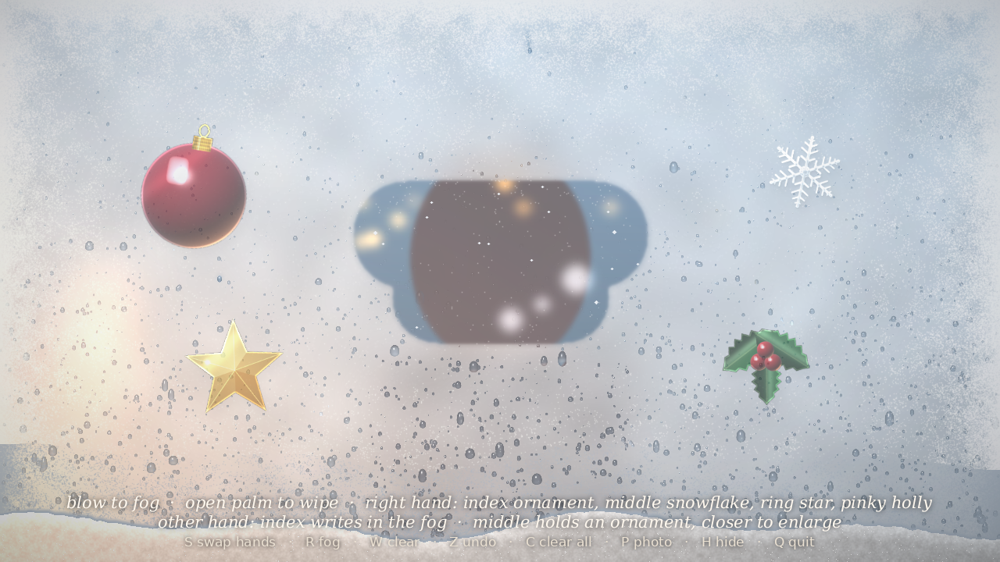

# 🎄 Christmas Fog Window

A cozy night window with you reflected in the glass. Blow on it to fog it up, wipe the fog away with your hand, and decorate the glass with Christmas stickers using hand gestures.


*(Preview made with a placeholder instead of a real camera feed.)*

## How to play

| Do this | What happens |
|---|---|
| 😮 **Open your mouth and blow** at the camera | The window fogs up, spreading out from your mouth |
| ✋ **Open palm** (either hand) | Wipes the fog off wherever your hand moves |
| 🤏 **Sticker hand:** thumb + **index** (each fingertip shows a mini preview of its sticker) | 🎄 Christmas tree pops out |
| thumb + **middle** | ⛄ Snowman |
| thumb + **ring** | 🎁 Gift |
| thumb + **pinky** | 🍬 Candy cane |
| 🤏 **Other hand:** pinch thumb + index on a sticker | Grab it, move it, and let go to place it |
| Drag a sticker to the circle in the corner | Removes it |

The sticker hand is your **right** hand by default. Press **S** to swap.

**Keys:** `S` swap hands · `R` fog the whole window · `W` clear all fog · `Z` undo · `C` clear stickers · `P` save a photo · `H` hide/show help · `F` fullscreen · `Q` quit

## Run it

```bash
cd christmas-fog-window
python3 -m venv .venv
source .venv/bin/activate          # Windows: .venv\Scripts\activate
pip install -r requirements.txt
python main.py
```

The first run downloads two small MediaPipe models (hand + face tracking) into this folder.

## Troubleshooting

- **Black screen or "Couldn't open the camera" on Mac:** go to System Settings → Privacy & Security → Camera and turn on access for Terminal (or VS Code). Then restart Terminal.
- **Wrong camera:** change `CAMERA_INDEX = 0` to `1` at the top of `main.py`.
- **`pip` can't find mediapipe:** your Python version is probably too new. Use Python 3.10–3.12, for example `python3.12 -m venv .venv`.
- **Fog triggers when you're just talking:** raise `MOUTH_OPEN` at the top of `main.py` (try `0.07`).
- **Want the fog to slowly come back after wiping:** set `FOG_REGROW_SECONDS = 25`.

## How it works

- **MediaPipe Face Landmarker** tracks your lips. When the gap between them is big enough, fog spreads out from your mouth.
- **MediaPipe Hand Landmarker** tracks 21 points on each hand. Fingertip distances detect pinches, and an open palm acts as the wiper.
- The fog is a mask over the camera image: blurred, lightened, and textured with tiny condensation droplets. Wiping draws holes in the mask.
- The window frame, garland, lights, candles, snow and stickers are all drawn with code (OpenCV + NumPy). There are no image files.

## Files

- `main.py`: camera loop, fog, gestures, stickers
- `window.py`: the night scene, window frame and decorations
- `stickers.py`: the Christmas stickers
- `text.py`: nicer fonts for the on-screen text
