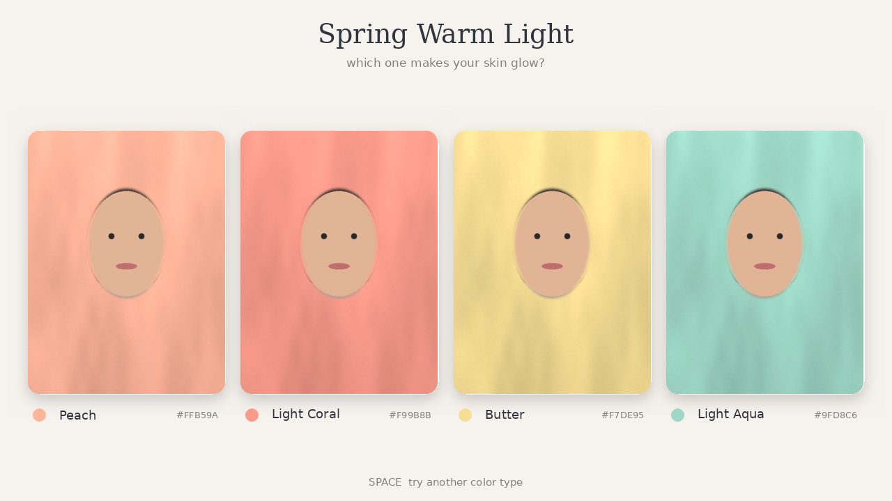

# 🎨 Personal Color Test

A Korean-style personal color draping test you can do at home with your webcam. Pick your color type, try 4 colors draped around your face with finger gestures, and compare the 4 photos side by side.


*(Preview made with a placeholder face instead of a real camera feed.)*

## How to use it

1. **Pick a color type.** Point your index finger at one of the 8 cards and hold it there for a second. You can also pinch on the card or press `1`–`8`.
2. **Try the colors.** The 4 colors of that type appear as dots on your fingertips:
   - index = color 1
   - middle = color 2
   - ring = color 3
   - pinky = color 4

   Touch your thumb to a finger, and a photo is snapped about a second later. While it's taken, the area around your face stays neutral grey, so your screen's light on your face is the same for every color. The test color is then added around your face in the photo, so all 4 photos compare fairly, without your skin picking up a glow from the screen.
3. **Compare.** After all 4 colors, the photos fill the screen side by side. Which one makes your skin glow? The comparison is saved automatically in `results/`.
4. Press **SPACE** to go back to the start and test another type.

If you want to retake a color, touch that finger again before the 4th photo.

**Keys:** `V` switch camera (remembered) · `1`–`8` pick a type · `1`–`4` try a color · `SPACE` start over · `P` save the screen · `F` fullscreen · `Q` quit

## The 8 color types

| Type | Feel | Test colors |
|---|---|---|
| Spring Warm Light | warm, light, clear | Peach, Light Coral, Butter, Light Aqua |
| Spring Warm Bright | warm, vivid | Coral Red, Tangerine, Sunflower, Turquoise |
| Summer Cool Light | cool, light, airy | Baby Pink, Lavender, Powder Blue, Cool Mint |
| Summer Cool Mute | cool, soft, greyish | Dusty Rose, Mauve, Grey Blue, Slate Teal |
| Autumn Warm Mute | warm, soft, earthy | Camel, Terracotta, Olive, Muted Teal |
| Autumn Warm Deep | warm, rich, dark | Brick, Mustard, Forest Olive, Chocolate |
| Winter Cool Bright | cool, vivid, high contrast | Fuchsia, True Red, Royal Blue, Emerald |
| Winter Cool Deep | cool, dark, intense | Wine, Navy, Plum, Black |

You can change any color in `palettes.py`.

## Tips for accurate results

- **Lighting matters most.** Sit facing a window in daylight. Avoid yellow lamps and colored LED lights, because they change how your skin looks.
- Take off makeup if you can. Real shops test on a bare face.
- Turn off camera filters and effects, like Center Stage or Portrait mode.
- Look for the color that makes your skin look clearer and brighter, with less visible shadows and redness. Avoid the ones that make you look tired or sallow.

## Run it

```bash
cd color-palette
conda activate xmas        # or any Python 3.10–3.12 environment
pip install -r requirements.txt
python main.py
```

The first run downloads the hand and face tracking models into this folder.

## How it works

- **MediaPipe Face Landmarker** finds the outline of your face (36 points around the face oval). Everything outside that outline is filled with the test color, with a fabric-like texture and soft edges, just like the white cap and colored cape used in Korean color shops.
- **MediaPipe Hand Landmarker** tracks your fingertips. A thumb-to-finger touch selects a color.
- Each photo is cropped to a 3:4 portrait around your face and shown in the tray on the right, then all 4 are laid out side by side.
